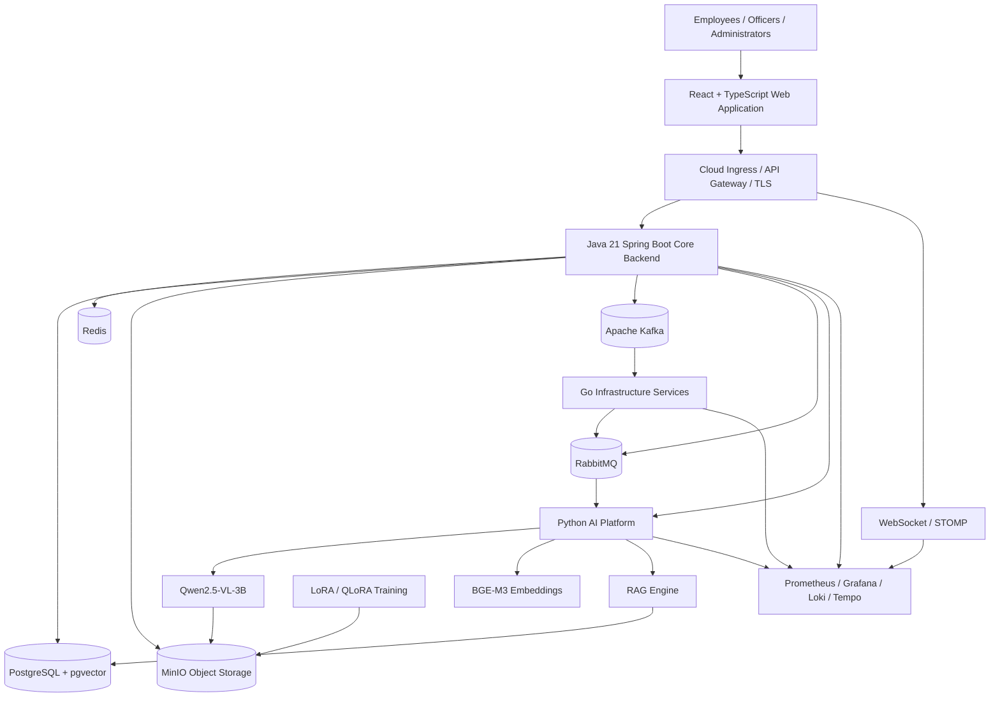
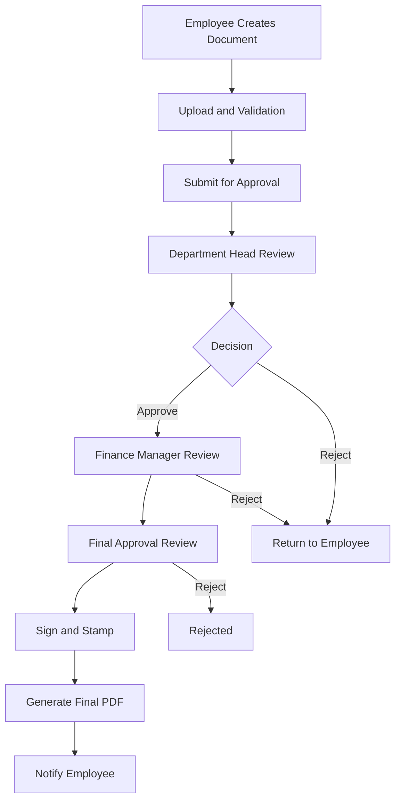

# DOCUMENT INTELLIGENCE & APPROVAL PLATFORM
## System Architecture Document (SAD)

**Document Version:** 2.0  
**Document Status:** Updated Architecture Baseline  
**Application Type:** Standalone, Independently Deployed Cloud Web Application  
**Deployment Model:** Cloud Production Deployment  
**Architecture Style:** Modular, Service-Oriented, Event-Driven Architecture  
**Backend:** Java 21 / Spring Boot 4.1.2 
**AI/ML:** Python / FastAPI  
**Infrastructure Services:** Go  
**Primary Database:** PostgreSQL  
**Object Storage:** MinIO  
**Vector Search:** PostgreSQL + pgvector  

---

# 1. DOCUMENT PURPOSE

## 1.1 Purpose

This document defines the technical architecture of the Document Intelligence & Approval Platform.

It describes the application's components, technology stack, service responsibilities, data architecture, communication patterns, AI/ML architecture, security, deployment infrastructure, observability and operational requirements.

It serves as the technical reference for:

- Backend engineering.
- Frontend engineering.
- AI/ML engineering.
- Infrastructure and DevOps engineering.
- Database engineering.
- Security engineering.
- Testing and quality assurance.
- Cloud deployment and operations.

## 1.2 Project Vision

The Document Intelligence & Approval Platform is an enterprise application designed to digitize, automate and improve organizational document management and approval processes.

The application will enable organizations to create, upload, review, process, approve, sign, stamp, track and retrieve business documents through a centralized platform.

It will incorporate AI capabilities to understand uploaded documents, extract information, assist users with document processing and answer questions using organizational policy documents through Retrieval-Augmented Generation (RAG).

The application will remain in control of all official business operations. AI will assist users but will not independently approve or reject documents.

## 1.3 Architecture Objectives

The architecture must:

1. Provide an independently deployed cloud application.
2. Own its authentication, user management and authorization.
3. Own its document-management and approval workflows.
4. Support configurable organizational approval processes.
5. Support PDF generation, signatures and stamping.
6. Integrate AI-powered document understanding.
7. Support LoRA and QLoRA fine-tuning.
8. Provide policy-based RAG using BGE-M3 and pgvector.
9. Use realistic synthetic organizational policies for initial development and testing.
10. Support asynchronous processing and event-driven communication.
11. Provide real-time notifications and application updates.
12. Maintain comprehensive audit records.
13. Support secure cloud deployment and horizontal scaling.
14. Provide centralized monitoring, logging and tracing.
15. Support automated testing, deployment and recovery.

---

# 2. APPLICATION ARCHITECTURE

## 2.1 Application Type

The platform will be a standalone, independently deployed cloud web application.

It will not depend on an external ERP, document-management system, approval platform or external identity provider to perform its core business functions.

The application will own:

- Web frontend.
- Backend APIs.
- Authentication and authorization.
- User and organization management.
- Document management.
- Approval workflow engine.
- Database.
- Object storage.
- AI/ML services.
- RAG knowledge base.
- Notification system.
- Audit system.
- Infrastructure and deployment configuration.
- Monitoring and operational services.

External services may be integrated later for optional capabilities such as SMS, email delivery or identity federation. Such integrations must not become mandatory dependencies for the core document-approval process.

## 2.2 Application Access

Users will access the application through a web browser using its independently configured domain.

Example:

`https://documents.example.com`

The application will support authorized access through the public internet or an organization's private network.

It will not require users to install a desktop application.

## 2.3 User Categories

### Employee / Document Sender

Responsibilities:

- Create documents.
- Upload existing documents.
- Select approved document templates.
- Submit documents for approval.
- Track document progress.
- View comments and rejection reasons.
- Respond to rejected documents.
- Download finalized documents.
- Ask questions about organizational policies.

### Approval Officer

Responsibilities:

- View assigned documents.
- Review document contents.
- Review extracted information and AI assistance.
- Add comments.
- Approve or reject documents.
- Apply authorized signatures and stamps.
- View previous approval activities.

### Administrator

Responsibilities:

- Manage users.
- Create users.
- Manage departments and offices.
- Configure roles and permissions.
- Manage document templates.
- Configure approval workflows.
- Manage policy documents.
- Manage organizational settings.
- Review audit records.
- Manage authorized signatures and stamps.

An administrator must not automatically receive approval authority. Administrative privileges and approval permissions must be independently configurable.

---

# 3. HIGH-LEVEL SYSTEM ARCHITECTURE

## 3.1 Architecture Diagram



## 3.2 Architecture Layers

The platform is divided into the following layers:

| Layer | Components | Responsibility |
|---|---|---|
| Presentation | React, TypeScript | User interface |
| Access | DNS, TLS, Ingress | Secure external access |
| Business application | Java, Spring Boot | Core business operations |
| AI/ML | Python, Qwen, BGE-M3 | Document intelligence and RAG |
| Data | PostgreSQL, pgvector | Structured and vector data |
| Object storage | MinIO | Document and model files |
| Cache | Redis | Frequently accessed temporary data |
| Event streaming | Kafka | Business event distribution |
| Background processing | RabbitMQ | Asynchronous task execution |
| Real-time | WebSocket, STOMP | Live application updates |
| Infrastructure | Go, Kubernetes, Docker | Selected infrastructure services and orchestration |
| Observability | Prometheus, Grafana, Loki, Tempo | Monitoring and diagnostics |
| Delivery | GitHub Actions | Automated testing and deployment |

---

# 4. TECHNOLOGY STACK

| Layer | Selected Technology |
|---|---|
| Frontend | React + TypeScript |
| Backend | Java 21 |
| Backend Framework | Spring Boot 4.1.2 |
| Build Tool | Maven |
| AI/ML Language | Python |
| AI Service Framework | FastAPI |
| Infrastructure Language | Go |
| Primary Database | PostgreSQL |
| Vector Extension | pgvector |
| Object Storage | MinIO |
| Cache | Redis |
| Event Streaming | Apache Kafka |
| Message Broker | RabbitMQ |
| Real-time Communication | WebSocket + STOMP |
| Vision-Language Model | Qwen2.5-VL-3B-Instruct |
| Embedding Model | BAAI/bge-m3 |
| Fine-tuning | LoRA / QLoRA |
| Model Training | PyTorch, Transformers, PEFT |
| Containerization | Docker |
| Orchestration | Kubernetes |
| Source Control | GitHub |
| CI/CD | GitHub Actions |
| Container Registry | GitHub Container Registry |
| Metrics | Prometheus |
| Dashboards | Grafana |
| Logging | Loki |
| Distributed Tracing | Tempo + OpenTelemetry |

**Versioning:** Java 21 is the Java runtime version, not Spring Boot 21. The implementation must pin a supported Spring Boot 3.x release and exact dependency versions. Python packages, container images and model revisions must also be version-controlled.

---

# 5. FRONTEND ARCHITECTURE

## 5.1 Technology

- React.
- TypeScript.
- Responsive web interface.
- REST API integration.
- WebSocket integration.

## 5.2 Frontend Modules

### Authentication Module

- Login.
- Logout.
- Password reset.
- Session management.
- Account recovery.

### Dashboard Module

- Total documents.
- Pending documents.
- Approved documents.
- Rejected documents.
- Recent activity.
- Assigned approval tasks.

### Document Management Module

- Create document.
- Upload document.
- Edit draft.
- Select template.
- Preview document.
- View document history.
- Download document.

### Template Management Module

- Create templates.
- Edit templates.
- Manage A4 layouts.
- Manage reusable form fields.
- Version templates.

### Approval Module

- Approval inbox.
- Assigned documents.
- Document review.
- Approval comments.
- Approve and reject actions.
- Approval history.

### Signature and Stamp Module

- Authorized signature management.
- Authorized stamp management.
- Signature placement.
- Stamp placement.
- Signature activity history.

### Policy Assistant Module

- Ask policy questions.
- View generated answers.
- View cited policy documents.
- View policy versions.
- Identify synthetic sample policy answers.

### Administration Module

- User management.
- Role management.
- Permission management.
- Department management.
- Office management.
- Workflow configuration.
- Policy management.
- Audit viewer.

## 5.3 Frontend Security

The frontend must not be trusted to enforce security.

Every protected operation must be authorized by the Java backend.

The frontend may hide unauthorized controls, but the backend must independently validate permissions before executing actions.

---

# 6. JAVA BACKEND ARCHITECTURE

## 6.1 Technology

- Java 21.
- Spring Boot 4.1.2.
- Maven.
- Spring Security.
- Spring Data JPA.
- Spring Web.
- Spring Validation.
- Spring Actuator.
- Spring Kafka.
- RabbitMQ integration.
- WebSocket and STOMP support.

## 6.2 Architectural Pattern

The initial backend will use a modular monolith architecture.

The modules will have explicit boundaries, independent domain responsibilities and controlled communication interfaces.

This provides a simpler initial deployment while preserving the ability to extract individual services later.

## 6.3 Backend Modules

| Module | Responsibility |
|---|---|
| Identity and Access | Authentication, users, roles and permissions |
| Organization | Organization, departments and offices |
| Document Management | Upload, metadata and document versions |
| Template Management | Company templates and document layouts |
| Workflow Engine | Approval stages and routing |
| Approval Management | Decisions, comments and assignments |
| Signature Management | Signature and stamp authorization |
| PDF Management | Final document generation |
| Notification Management | Notification records and delivery |
| Policy Management | Policy versions and publication |
| Audit Management | Activity and decision history |
| AI Integration | Communication with Python services |
| Event Integration | Kafka and RabbitMQ integration |

## 6.4 Java Backend Project Structure

```text
backend/
├── src/main/java/com/company/documentplatform/
│   ├── identity/
│   ├── organization/
│   ├── user/
│   ├── document/
│   ├── template/
│   ├── workflow/
│   ├── approval/
│   ├── signature/
│   ├── pdf/
│   ├── notification/
│   ├── policy/
│   ├── audit/
│   ├── integration/
│   └── shared/
│
├── src/main/resources/
│   ├── application.properties
│   └── db/migration/
│
└── pom.xml
```

## 6.5 Business Authority

Java owns:

- Official document status.
- Approval decisions.
- Workflow transitions.
- User permissions.
- Approval assignments.
- Signature authorization.
- Finalization decisions.
- Audit records.

Python AI services must not independently approve, reject, sign or modify official workflow states.

---

# 7. PYTHON AI/ML ARCHITECTURE

## 7.1 Technology

- Python.
- FastAPI.
- PyTorch.
- Hugging Face Transformers.
- Hugging Face Datasets.
- PEFT.
- Accelerate.
- bitsandbytes where supported.
- MLflow or an equivalent experiment-tracking system.

## 7.2 AI Services

| Service | Responsibility |
|---|---|
| Document AI | Document understanding and extraction |
| Qwen Inference | Vision-language model inference |
| Embedding Service | BGE-M3 embeddings |
| RAG Engine | Policy retrieval and answer generation |
| Policy Ingestion | Policy extraction and indexing |
| Training Service | LoRA/QLoRA fine-tuning |
| Evaluation Service | Model and retrieval evaluation |

These services may initially be grouped into fewer deployable Python applications, provided their responsibilities and interfaces remain clearly separated.

## 7.3 Document AI Processing

The document-processing workflow:

1. Java validates the submission.
2. Original document is uploaded to MinIO.
3. Java records document metadata in PostgreSQL.
4. A processing event or job is generated.
5. The document is validated and scanned.
6. PDF pages are extracted or rendered as images.
7. Python sends the relevant content to Qwen.
8. Qwen generates structured extraction results.
9. Python validates the response schema.
10. Java validates business-specific fields and stores the accepted result.
11. The frontend displays processing status and results.

AI extraction is an assistance feature. Users and authorized business rules must be able to handle incorrect or incomplete results.

---

# 8. QWEN2.5-VL-3B MODEL ARCHITECTURE

## 8.1 Selected Model

`Qwen/Qwen2.5-VL-3B-Instruct`

Purpose: visual document understanding.

## 8.2 Intended Functions

- Document classification.
- Invoice information extraction.
- Form understanding.
- Table and layout interpretation.
- Scanned document understanding.
- Visual question answering.
- Structured field extraction.

## 8.3 Fine-tuning Strategy

The platform will use LoRA or QLoRA depending on GPU capacity and training requirements.

### LoRA

LoRA freezes the original model weights and trains small adapter parameters.

Advantages:

- Reduced trainable parameters.
- Lower training cost than full fine-tuning.
- Smaller adapter artifacts.
- Easier model version management.

### QLoRA

QLoRA quantizes the frozen base model, commonly to 4-bit, while training LoRA adapters.

Advantages:

- Lower GPU memory requirements.
- More accessible fine-tuning on limited GPU resources.
- Efficient adapter-based training.

QLoRA is an alternative training configuration, not a required second phase after LoRA.

## 8.4 Training Pipeline

```text
Licensed Dataset
       |
       v
License and Provenance Review
       |
       v
Data Cleaning
       |
       v
Train / Validation / Test Split
       |
       v
LoRA or QLoRA Configuration
       |
       v
GPU Training
       |
       v
Model Evaluation
       |
       v
Adapter Versioning
       |
       v
MinIO Model Storage
       |
       v
Staging Deployment
       |
       v
Production Promotion
```

## 8.5 Dataset Candidates

Potential Hugging Face datasets to investigate:

- `pixparse/docvqa-single-page-questions`
- FUNSD
- RVL-CDIP

Before using any dataset, verify:

- Current dataset-card license.
- Underlying source-document rights.
- Commercial-use permission.
- Redistribution restrictions.
- Personal-data exposure.
- Dataset provenance.

Do not assume a dataset is commercially usable merely because it is publicly downloadable.

Organization-owned, anonymized and authorized examples should eventually be included to improve performance on the organization's actual documents.

## 8.6 Model Licensing

The current model repository and license terms must be reviewed before production deployment.

Obtain commercial permission where required. Keep model integration behind an abstraction layer so another model can be substituted without redesigning the entire platform.

---

# 9. BGE-M3 AND RAG ARCHITECTURE

## 9.1 Selected Embedding Model

`BAAI/bge-m3`

Purpose: convert policy text and user questions into embeddings for semantic retrieval.

BGE-M3 is not the answer-generating language model.

## 9.2 RAG Components

- Policy documents.
- Policy ingestion service.
- Text extraction.
- Text normalization.
- Chunking.
- BGE-M3 embedding generation.
- PostgreSQL + pgvector.
- Retrieval service.
- Optional reranking.
- Qwen answer generation.
- Citation generation and validation.

## 9.3 Synthetic Organizational Policy Corpus

The initial RAG knowledge base will use realistic, internally consistent fictional organizational policies.

Suggested fictional organization:

**Meridian Corporate Services Ltd.**

All initial sample policies must carry this label:

`SYNTHETIC SAMPLE — NOT AN APPROVED REAL-WORLD POLICY`

### Policy Library

| Policy | Contents |
|---|---|
| Financial Management Policy | Spending limits and financial authorization |
| Procurement Policy | Purchase requests and vendor selection |
| Document Approval Policy | Approval levels and workflow rules |
| Leave Management Policy | Leave application and authorization |
| Travel and Expense Policy | Travel approval and reimbursement |
| Human Resources Policy | Employee administration |
| Information Security Policy | Passwords and information protection |
| Records Retention Policy | Document retention and disposal |

## 9.4 Illustrative Approval Thresholds

The synthetic Financial Management Policy may contain:

| Purchase amount | Approval requirement |
|---|---|
| Up to ₦500,000 | Department Head |
| Above ₦500,000 up to ₦5,000,000 | Department Head + Finance Manager |
| Above ₦5,000,000 | Department Head + Finance Manager + Managing Director |

These are fictional testing values only. They are not real company policy, statutory requirements or financial advice.

## 9.5 Policy Metadata

Each policy should include:

- Policy ID.
- Organization ID.
- Policy title.
- Category.
- Version.
- Effective date.
- Review date.
- Approval status.
- Section number.
- Page reference.
- Source document reference.
- Access classification.
- Data classification: `SYNTHETIC_SAMPLE` or `REAL_ORGANIZATION_POLICY`.

## 9.6 RAG Ingestion Pipeline

```text
Policy Document
      |
      v
Store Original in MinIO
      |
      v
Python Ingestion Service
      |
      v
Text Extraction
      |
      v
Normalization
      |
      v
Text Chunking
      |
      v
BGE-M3 Embeddings
      |
      v
PostgreSQL + pgvector
```

## 9.7 RAG Query Pipeline

1. User asks a policy question.
2. Java authenticates the user.
3. Java establishes the authorized organization and access scope.
4. Python receives the question and trusted access context.
5. BGE-M3 generates the question embedding.
6. The RAG service retrieves relevant policy chunks.
7. Organization, access, status and version filters are applied.
8. Dense and sparse retrieval can be combined.
9. An optional reranker improves the retrieved ranking.
10. Qwen generates an answer from retrieved policy evidence.
11. The RAG service returns the answer and supporting references.
12. The frontend displays the answer and citations.

## 9.8 RAG Answer Rules

- Answers must be grounded in retrieved policy evidence.
- Policy name, version and section must be cited.
- The system must identify synthetic policy content.
- The assistant must state when no supporting policy is found.
- Retired policies must not be treated as current policies.
- User access restrictions must apply during retrieval.
- The assistant must not invent policy clauses.
- RAG recommendations must not become official approval decisions.

**Important architecture boundary:** RAG explains policies. Java implements and enforces approved operational rules.

---

# 10. DATABASE ARCHITECTURE

## 10.1 Primary Database

PostgreSQL.

## 10.2 Vector Search

PostgreSQL with pgvector.

## 10.3 Main Data Domains

| Domain | Records |
|---|---|
| Organization | Organizations, departments, offices |
| Identity | Users, roles, permissions and sessions |
| Documents | Document metadata and versions |
| Templates | Template records and versions |
| Workflow | Workflow definitions and stages |
| Approval | Assignments, comments and decisions |
| Signature | Signature and stamp records |
| Policy | Policy metadata and versions |
| RAG | Chunks, embeddings and source references |
| Notification | Notifications and delivery attempts |
| Audit | User and system activity |
| AI | Model versions and processing records |

## 10.4 Data Ownership

- Java owns business data and business transactions.
- Python owns AI execution and retrieval logic.
- AI outputs are submitted through controlled interfaces.
- PostgreSQL is the source of truth.
- Redis is not authoritative.
- MinIO stores binary objects; PostgreSQL stores metadata and object keys.

## 10.5 Organization Isolation

The data architecture should support organization-scoped records.

Use organization identifiers in relevant records and enforce access restrictions in Java.

PostgreSQL Row-Level Security may provide additional protection. It must not replace application authorization.

The implementation must prevent users from changing a request parameter to access another organization's records.

---

# 11. MINIO OBJECT STORAGE

## 11.1 Technology

MinIO, an S3-compatible object-storage platform.

## 11.2 Storage Responsibilities

- Original PDFs.
- Uploaded documents.
- Scanned images.
- Extracted page images.
- Document previews.
- Templates.
- Final approved PDFs.
- Signatures.
- Stamps.
- Policy source files.
- Training datasets.
- Model adapters and checkpoints.

## 11.3 Suggested Bucket Organization

```text
document-platform/
├── organization-files/
├── original-documents/
├── processed-documents/
├── document-previews/
├── templates/
├── final-approved-documents/
├── signatures/
├── stamps/
├── policy-documents/
├── training-datasets/
└── model-artifacts/
```

## 11.4 Security

- Private buckets.
- TLS.
- Encryption at rest.
- Least-privilege service accounts.
- Short-lived presigned URLs.
- Versioning where required.
- Backup and recovery.
- Organization-scoped object access.

Permanent storage credentials must never be exposed to the browser.

---

# 12. REDIS CACHE ARCHITECTURE

## 12.1 Purpose

Redis provides fast access to frequently requested temporary information.

## 12.2 Use Cases

- User and permission lookup acceleration.
- Dashboard statistics.
- Workflow metadata.
- Frequently accessed document metadata.
- API rate limiting.
- Temporary processing status.
- Short-lived, permission-scoped RAG query caching.
- Shared WebSocket event fanout where configured.

## 12.3 Cache Rules

- PostgreSQL remains authoritative.
- Cache entries require suitable expiration.
- Important updates must trigger invalidation or refresh.
- Cache keys must be organization- and user-scoped where necessary.
- Cached permissions must not be the sole authorization decision.
- Redis failure must not destroy official business records.

---

# 13. KAFKA EVENT ARCHITECTURE

## 13.1 Purpose

Kafka distributes durable business events across application components.

## 13.2 Proposed Topics

```text
document.created
document.submitted
document.uploaded
document.processing.requested
document.processing.completed
document.ai-analysis.requested
document.ai-analysis.completed
approval.assigned
approval.completed
document.rejected
document.finalized
policy.published
policy.retired
notification.requested
```

## 13.3 Event Example

```json
{
  "eventId": "evt-100001",
  "eventType": "document.submitted",
  "organizationId": "org-001",
  "documentId": "doc-10001",
  "actorId": "user-100",
  "occurredAt": "2026-11-06T10:00:00Z",
  "schemaVersion": 1
}
```

## 13.4 Transactional Outbox

Java must commit business changes and corresponding outbox records in the same PostgreSQL transaction.

An outbox publisher subsequently publishes the events to Kafka.

Consumers must be idempotent because duplicate event delivery is possible.

Use event schema versioning, correlation IDs, retries and dead-letter handling.

---

# 14. RABBITMQ BACKGROUND JOB ARCHITECTURE

## 14.1 Purpose

RabbitMQ distributes asynchronous jobs to background workers.

## 14.2 Proposed Queues

```text
document.validation
document.ocr
document.pdf-rendering
document.thumbnail
document.ai-inference
document.embedding
policy.ingestion
notification.email
notification.reminder
document.archive
```

## 14.3 Processing Flow

1. A service publishes a job.
2. RabbitMQ places it in the relevant queue.
3. A worker receives the job.
4. The worker executes the operation.
5. Successful execution is acknowledged.
6. Failed jobs are retried according to policy.
7. Repeated failures enter a dead-letter queue.

## 14.4 Kafka and RabbitMQ Separation

Kafka is used for business event distribution and replay.

RabbitMQ is used for background task execution, acknowledgements and retry handling.

A controlled event adapter may translate selected Kafka events into RabbitMQ jobs. It must not indiscriminately forward all events.

---

# 15. GO INFRASTRUCTURE SERVICES

Go will be used for selected infrastructure-oriented services.

Potential responsibilities:

- Kafka-to-RabbitMQ event adapter.
- Infrastructure health aggregation.
- Operational workers.
- Selected high-throughput integration services.

Go must not duplicate Java's business rules, approval authority or ownership of business records.

Each Go service must have a defined API, health endpoint, logging, metrics and failure-handling strategy.

---

# 16. WEBSOCKET AND REAL-TIME ARCHITECTURE

## 16.1 Technology

WebSocket + STOMP.

## 16.2 Use Cases

- Approval assignment notifications.
- Document status updates.
- Rejection and approval notifications.
- AI processing progress.
- PDF generation completion.
- Review comments.
- In-app alerts.

## 16.3 Security

- Authenticate connections.
- Authorize subscriptions.
- Scope topics to the authorized user and organization.
- Validate messages.
- Apply rate limits.
- Handle reconnects.
- Persist notification history in PostgreSQL.

For multiple WebSocket replicas, use a shared event-fanout mechanism.

Redis Pub/Sub may provide fanout, but PostgreSQL must retain durable notification history.

---

# 17. DOCUMENT APPROVAL WORKFLOW

## 17.1 Workflow Overview



The diagram illustrates a possible workflow. The actual approval stages will be configurable.

## 17.2 Workflow Requirements

- Configurable approval stages.
- Sequential and parallel approval.
- Configurable approval authority.
- Assignment and delegation.
- Approval comments.
- Rejection reasons.
- Reminders and escalation.
- Approval history.
- Authorized signing and stamping.
- Final document generation.

## 17.3 Approval Security

- Users cannot approve their own documents unless an explicit, authorized exception exists.
- Officers can only act on authorized assignments.
- Rejections require a reason.
- Approval decisions must be attributable to authenticated users.
- Completed approval records must not be silently modified.
- Every workflow transition must be audited.

---

# 18. PDF GENERATION AND SIGNATURE ARCHITECTURE

## 18.1 Responsibilities

The PDF subsystem will:

- Generate final approved PDFs.
- Apply authorized visual signatures.
- Apply approved organizational stamps.
- Include relevant approval information.
- Store finalized document versions.
- Maintain document checksums and references.

## 18.2 Finalization Process

1. Java verifies workflow completion.
2. Java validates approval authority.
3. The PDF service assembles the final document.
4. Authorized signatures and stamps are applied.
5. The PDF is stored in MinIO.
6. PostgreSQL stores the file reference, checksum and version.
7. The sender receives a notification.

## 18.3 Digital Signature Distinction

A visual signature image is not equivalent to a cryptographic digital signature.

If cryptographic signing is required, implement certificate-based signing and validation or integrate an appropriate signing service.

---

# 19. NOTIFICATION ARCHITECTURE

## 19.1 Notification Channels

- In-app notifications.
- Email.
- WebSocket.

## 19.2 Notification Events

- Document submitted.
- Approval assigned.
- Approval reminder.
- Document rejected.
- Document returned for correction.
- Document approved.
- Final PDF generated.
- Final document ready for download.

Notification records and delivery attempts must be persisted in PostgreSQL.

RabbitMQ workers will handle retryable delivery.

A failed notification must not roll back a successfully committed approval decision.

---

# 20. SECURITY ARCHITECTURE

## 20.1 Identity Security

- Secure password hashing.
- Optional MFA.
- Role-based and permission-based authorization.
- Organization-scoped access.
- Session expiration.
- Login rate limiting.
- Secure password reset.
- Administrative activity auditing.

## 20.2 Network Security

- HTTPS and TLS.
- Private database access.
- Private broker access.
- Private object-storage access.
- Network segmentation.
- Kubernetes NetworkPolicies.
- Restricted administrative endpoints.

## 20.3 Data Security

- Encryption at rest.
- Encryption in transit.
- Secure secrets management.
- Short-lived file access URLs.
- Least-privilege service identities.
- Retention and deletion policies.
- Backup protection.

## 20.4 AI Security

- Uploaded documents are untrusted inputs.
- Detect and mitigate prompt injection.
- Validate model outputs.
- Do not execute model-generated instructions as privileged operations.
- Apply authorization before RAG retrieval.
- Restrict access to confidential documents.
- Record relevant model and processing metadata.
- Do not send confidential content to external AI providers without explicit approval.

## 20.5 Audit Records

Audit records should include:

- User identity.
- Organization.
- Action.
- Resource or document identifier.
- Timestamp.
- Previous and new state where appropriate.
- Correlation ID.
- Relevant source context.
- AI model version for AI-assisted operations.

Normal application users must not be able to modify or erase audit history.

---

# 21. OBSERVABILITY ARCHITECTURE

## 21.1 Technology

| Technology | Responsibility |
|---|---|
| Prometheus | Metrics collection |
| Grafana | Dashboards |
| Loki | Centralized logs |
| Tempo | Distributed tracing |
| OpenTelemetry | Telemetry instrumentation |
| Alertmanager | Alert management |

## 21.2 Monitoring Categories

### Application

- API request rate.
- API response time.
- HTTP error rate.
- JVM heap and garbage collection.
- Authentication failures.

### Document Processing

- Submission volume.
- Processing duration.
- Failed processing jobs.
- PDF generation duration.
- Pending processing jobs.

### AI/ML

- Qwen inference latency.
- GPU utilization.
- GPU memory.
- Extraction validation failures.
- Embedding throughput.
- RAG retrieval latency.
- Citation evaluation results.

### Messaging

- Kafka consumer lag.
- RabbitMQ queue depth.
- Unacknowledged messages.
- Retry counts.
- Dead-letter queue volume.

### Infrastructure

- CPU and memory.
- Kubernetes pod restarts.
- Node health.
- PostgreSQL performance.
- Redis memory and hit rate.
- MinIO storage capacity.

## 21.3 Alerting

Configure alerts for:

- Application unavailability.
- Database connection failures.
- Broker unavailability.
- Growing dead-letter queues.
- AI service failures.
- GPU memory pressure.
- Storage capacity exhaustion.
- Backup failures.
- Abnormal API error rates.

Thresholds should be based on measured baselines and agreed service-level objectives.

---

# 22. DOCKER CONTAINER ARCHITECTURE

## 22.1 Containerized Components

```text
frontend-web
java-core-backend
python-document-ai
python-qwen-inference
python-bge-embedding
python-rag-service
python-model-training
go-event-adapter
go-infrastructure-worker
postgresql
redis
minio
kafka
rabbitmq
prometheus
grafana
loki
tempo
```

Not every component must initially be a separate deployment. Services may be grouped where appropriate, provided boundaries remain clear.

## 22.2 Container Standards

- Multi-stage builds.
- Minimal maintained base images.
- Non-root execution.
- Pinned dependency versions.
- Image vulnerability scanning.
- No secrets inside images.
- Health checks.
- Resource limits.
- Persistent storage for stateful workloads.
- Centralized logs.

---

# 23. KUBERNETES DEPLOYMENT ARCHITECTURE

## 23.1 Proposed Namespaces

| Namespace | Components |
|---|---|
| platform-system | Ingress and shared platform services |
| document-app | Frontend and Java backend |
| document-ai | Python AI, RAG and embeddings |
| document-workers | Background workers |
| document-data | Database, cache, storage and brokers when self-hosted |
| document-monitoring | Monitoring and observability |

## 23.2 Kubernetes Resources

- Deployments.
- Services.
- Ingress.
- ConfigMaps.
- Secrets or external secrets integration.
- Horizontal Pod Autoscalers.
- Jobs.
- CronJobs.
- PersistentVolumeClaims.
- NetworkPolicies.
- PodDisruptionBudgets.

## 23.3 GPU Node Pool

Use dedicated GPU nodes for:

- Qwen inference.
- LoRA/QLoRA training.
- GPU-dependent AI workloads.

Training and production inference should have separate resource controls and preferably separate workloads.

## 23.4 Stateful Services

PostgreSQL, Kafka, RabbitMQ, Redis and MinIO require explicit backup, persistence, replication, upgrade and recovery plans.

Managed or separately operated stateful infrastructure may be preferable for the first production release.

Kubernetes itself does not guarantee database backup or data recovery.

---

# 24. CLOUD DEPLOYMENT ARCHITECTURE

## 24.1 Deployment Topology

```text
Internet / Organization Network
              |
              v
          DNS + TLS
              |
              v
        Cloud Ingress
              |
       +------+------+
       |             |
       v             v
   Frontend       API / WebSocket
                       |
                       v
                  Java Backend
                       |
       +---------------+----------------+
       |               |                |
       v               v                v
   PostgreSQL        Redis             MinIO
       |
       +-------------------------------+
       |               |               |
       v               v               v
     Kafka          RabbitMQ       AI Services
       |               |               |
       v               v               v
    Go Adapter       Workers       Qwen / BGE / RAG
                                       |
                                       v
                                  pgvector

       Prometheus / Loki / Tempo
                   |
                   v
                 Grafana
```

## 24.2 Network Zones

1. Public zone: ingress and externally accessible web entry points.
2. Application zone: Java, Python and Go services.
3. Data zone: PostgreSQL, Redis, Kafka, RabbitMQ and MinIO.
4. Monitoring zone: Prometheus, Grafana, Loki and Tempo.
5. GPU zone: Qwen inference and training workloads.

Databases, brokers, MinIO administration and internal AI endpoints must not be exposed directly to public traffic.

## 24.3 Environments

Maintain separate:

- Development.
- Integration testing.
- Staging.
- Production.

Each environment must have appropriately isolated databases, storage, credentials, messaging and model configurations.

---

# 25. GITHUB REPOSITORY AND CI/CD

## 25.1 Repository Structure

```text
document-intelligence-platform/
│
├── frontend/
│   └── web-app/
│
├── backend/
│   └── java-core/
│
├── ai-services/
│   ├── document-ai/
│   ├── qwen-inference/
│   ├── bge-embedding/
│   ├── rag-engine/
│   ├── policy-ingestion/
│   ├── model-training/
│   └── evaluation/
│
├── infrastructure-services/
│   └── go/
│
├── infrastructure/
│   ├── docker/
│   ├── kubernetes/
│   ├── helm/
│   └── terraform/
│
├── monitoring/
├── database/
│   ├── migrations/
│   └── seed-data/
│
├── docs/
│   ├── architecture/
│   ├── api/
│   ├── security/
│   ├── deployment/
│   └── operations/
│
└── .github/
    └── workflows/
```

## 25.2 CI Pipeline

- Java tests.
- Python tests.
- Go tests.
- Frontend tests.
- Static analysis.
- Dependency security scans.
- Container image builds.
- Container vulnerability scans.

## 25.3 CD Pipeline

1. Build versioned artifacts.
2. Push images to GHCR.
3. Deploy to staging.
4. Run smoke tests.
5. Run integration checks.
6. Require production approval where configured.
7. Deploy to production.
8. Verify readiness and health.
9. Roll back if deployment validation fails.

Use protected branches, GitHub environment protections, short-lived OIDC authentication where supported and external secret management.

## 25.4 Model Deployment Pipeline

Model training and deployment must be separately controlled.

- Verify dataset rights.
- Record base-model revision.
- Train adapter.
- Evaluate quality.
- Record evaluation results.
- Store approved adapter in MinIO.
- Deploy to staging.
- Validate against regression tests.
- Promote to production.
- Retain rollback capability.

---

# 26. API ARCHITECTURE

## 26.1 Public Application APIs

| Module | Example Endpoint |
|---|---|
| Authentication | `/api/v1/auth/login` |
| Users | `/api/v1/users` |
| Organizations | `/api/v1/organizations` |
| Documents | `/api/v1/documents` |
| Templates | `/api/v1/templates` |
| Workflow | `/api/v1/workflows` |
| Approvals | `/api/v1/approvals` |
| Signatures | `/api/v1/signatures` |
| Notifications | `/api/v1/notifications` |
| Policies | `/api/v1/policies` |
| Policy Assistant | `/api/v1/policy-assistant/questions` |
| Audit | `/api/v1/audit` |

## 26.2 Internal AI APIs

```text
POST /internal/v1/document-analysis
POST /internal/v1/document-extraction
POST /internal/v1/embeddings
POST /internal/v1/rag/query
POST /internal/v1/policies/ingestion
GET  /internal/v1/models/health
GET  /internal/v1/processing/{jobId}
```

## 26.3 API Standards

- Versioned APIs.
- Input validation.
- Consistent error responses.
- Authorization on every protected operation.
- Pagination.
- Idempotency for retry-sensitive operations.
- Correlation IDs.
- OpenAPI documentation.
- No exposed stack traces or secrets.

---

# 27. CONFIGURATION MANAGEMENT

Java will use `application.properties`.

Example:

```properties
spring.application.name=document-platform

server.port=${SERVER_PORT:8080}

spring.datasource.url=${DB_URL}
spring.datasource.username=${DB_USERNAME}
spring.datasource.password=${DB_PASSWORD}

spring.data.redis.host=${REDIS_HOST}
spring.data.redis.port=${REDIS_PORT:6379}

spring.kafka.bootstrap-servers=${KAFKA_BOOTSTRAP_SERVERS}

spring.rabbitmq.host=${RABBITMQ_HOST}
spring.rabbitmq.port=${RABBITMQ_PORT:5672}
spring.rabbitmq.username=${RABBITMQ_USERNAME}
spring.rabbitmq.password=${RABBITMQ_PASSWORD}

app.storage.endpoint=${MINIO_ENDPOINT}
app.storage.bucket=${MINIO_BUCKET}
app.storage.access-key=${MINIO_ACCESS_KEY}
app.storage.secret-key=${MINIO_SECRET_KEY}

app.ai.document-service-url=${AI_DOCUMENT_SERVICE_URL}
app.ai.rag-service-url=${AI_RAG_SERVICE_URL}

management.endpoints.web.exposure.include=health,info,prometheus
management.endpoint.health.probes.enabled=true
```

Secrets must be supplied through a secure external configuration mechanism. Add environment-specific connection pools, TLS, timeouts, credential rotation and operational settings before production.

---

# 28. RELIABILITY AND FAILURE HANDLING

## 28.1 Reliability Requirements

- Multiple replicas for critical stateless services.
- Health and readiness checks.
- Graceful shutdown.
- Bounded retries.
- Exponential backoff and jitter.
- Idempotent consumers.
- Dead-letter queues.
- Database connection-pool controls.
- Service timeouts.
- Circuit breakers where appropriate.
- Persistent storage.
- Backup and recovery procedures.

## 28.2 Failure Scenarios

| Failure | Expected behavior |
|---|---|
| Qwen unavailable | Mark AI analysis pending and retry |
| Email failure | Preserve decision and retry notification |
| WebSocket disconnect | Reconnect and retrieve persisted notifications |
| Redis unavailable | Use controlled database fallback where practical |
| RabbitMQ unavailable | Retain pending work and resume delivery |
| Kafka unavailable | Retain outbox records and publish after recovery |
| MinIO unavailable | Do not report file upload or finalization as successful without verified storage |
| PostgreSQL unavailable | Stop authoritative business writes and recover safely |

---

# 29. BACKUP AND DISASTER RECOVERY

## 29.1 Backup Requirements

| Asset | Protection |
|---|---|
| PostgreSQL | Automated backups and supported point-in-time recovery |
| MinIO | Replication or backup to independent storage |
| Redis | Rebuildable cache; persistence where needed |
| Kafka | Replication and appropriate retention |
| RabbitMQ | Durable queues and message persistence where required |
| Model adapters | Versioned storage and independent backup |
| GitHub | Protected repositories and backup strategy |
| Kubernetes configuration | Version-controlled manifests and infrastructure definitions |

## 29.2 Recovery Objectives

Define:

- Recovery Point Objective (RPO).
- Recovery Time Objective (RTO).
- Retention periods.
- Backup encryption.
- Recovery ownership.
- Restore testing frequency.

A backup must be tested through an actual restoration procedure. A successful backup job alone does not prove recoverability.

---

# 30. PERFORMANCE AND SCALABILITY

| Component | Scaling Strategy |
|---|---|
| React frontend | Static asset delivery and CDN |
| Java backend | Multiple replicas and horizontal scaling |
| Python APIs | Independent service replicas |
| Qwen inference | GPU-aware scaling and request queueing |
| Model training | Dedicated GPU jobs |
| BGE-M3 | Batch processing and worker scaling |
| RAG | Database indexes and retrieval optimization |
| RabbitMQ | Worker scaling based on queue depth |
| Kafka | Consumer groups and partition planning |
| WebSocket | Multiple replicas and shared event fanout |
| MinIO | Capacity and availability planning |

AI inference must not block ordinary document-submission requests unnecessarily.

Use asynchronous processing for expensive document understanding, embedding and PDF tasks.

Performance targets must be established through load testing and agreed service-level objectives.

---

# 31. TESTING STRATEGY

| Test Type | Objective |
|---|---|
| Unit Testing | Validate individual functions and rules |
| Integration Testing | Validate database and service interactions |
| API Testing | Validate API contracts and authorization |
| Workflow Testing | Validate approval transitions |
| AI Evaluation | Measure extraction accuracy |
| RAG Evaluation | Measure retrieval and answer quality |
| Security Testing | Validate authentication and access restrictions |
| Performance Testing | Validate throughput and latency |
| Resilience Testing | Validate recovery from failures |
| Disaster Recovery Testing | Validate restoration |
| End-to-End Testing | Validate the full document lifecycle |

## 31.1 AI Evaluation

Evaluate:

- Field extraction accuracy.
- Precision and recall.
- Confidence calibration.
- Document classification.
- Table extraction.
- Failure handling.

## 31.2 RAG Evaluation

Evaluate:

- Retrieval recall.
- Relevant-document ranking.
- Citation correctness.
- Answer groundedness.
- Unsupported-answer refusal.
- Policy version correctness.
- Organization access isolation.

Use a fixed evaluation set with expected policy sources and expected answers.

---

# 32. SYNTHETIC POLICY DATA IMPLEMENTATION

The initial RAG corpus will use realistic fictional organizational policy documents for Meridian Corporate Services Ltd.

All sample documents must clearly state:

`SYNTHETIC SAMPLE — NOT AN APPROVED REAL-WORLD POLICY`

The corpus should contain internally consistent policies covering:

1. Financial Management.
2. Procurement.
3. Document Approval.
4. Leave Management.
5. Travel and Expense.
6. Human Resources.
7. Information Security.
8. Records Retention.

Policy references should use explicit policy IDs, versions and section references.

Sample policies must be stored and indexed separately from actual approved organizational policies.

The administrator must be able to replace sample documents with approved real policies.

When a policy changes, the system must maintain version history, re-index the approved version and prevent retired versions from being presented as current rules.

---

# 33. PRODUCTION ACCEPTANCE CRITERIA

The platform must demonstrate the following before production acceptance:

| Area | Acceptance Requirement |
|---|---|
| Standalone Deployment | Independently deployed on its own cloud domain |
| Authentication | Secure login and session management |
| Authorization | Correct user and organization access |
| Document Management | Secure upload, versioning, preview and download |
| Workflow | Configurable approval stages |
| Approval Security | AI cannot make official approval decisions |
| PDF | Final approved PDF generated and stored |
| MinIO | Secure object storage and recovery |
| Redis | Cache failure does not compromise business records |
| Kafka | Reliable event publication and consumption |
| RabbitMQ | Reliable jobs, retries and dead-letter handling |
| WebSocket | Authorized live updates |
| Qwen | Document performance evaluated |
| Fine-tuning | Dataset rights and model licensing documented |
| RAG | Grounded answers with source references |
| Synthetic Data | Clearly labeled and isolated |
| Grafana | Functional monitoring and alerts |
| CI/CD | Repeatable build, test and deployment |
| Disaster Recovery | Successful restoration testing |
| Security | Security assessment and remediation completed |

---

# 34. IMPLEMENTATION ROADMAP

| Phase | Work | Deliverable |
|---|---|---|
| 1 | Cloud foundation, repository and infrastructure | Development environment |
| 2 | Java backend and PostgreSQL | Authentication and organization management |
| 3 | MinIO and document management | Document upload and storage |
| 4 | Approval workflow | Working approval lifecycle |
| 5 | Redis, Kafka and RabbitMQ | Cache and asynchronous processing |
| 6 | WebSocket and notifications | Real-time application updates |
| 7 | Qwen and Python AI | Document understanding |
| 8 | LoRA/QLoRA | Fine-tuned model |
| 9 | BGE-M3 and RAG | Policy assistant |
| 10 | PDF finalization | Signed and stamped final documents |
| 11 | Go infrastructure services and monitoring | Operational infrastructure |
| 12 | Kubernetes and CI/CD hardening | Production deployment |
| 13 | Security, performance and recovery testing | Production acceptance |

## 34.1 Recommended First Milestone

Before implementing advanced AI features, establish a working document-approval lifecycle:

1. User logs in.
2. User creates or uploads a document.
3. User submits the document.
4. The application assigns the correct approval officers.
5. Officers review and make authorized decisions.
6. The application generates the final approved PDF.
7. The sender receives the notification.
8. All actions are recorded in the audit trail.

Once this core lifecycle is reliable, integrate document AI, fine-tuning and RAG.

---

# 35. FINAL ARCHITECTURE DECISIONS

| Area | Final Decision |
|---|---|
| Application Type | Standalone cloud web application |
| Deployment | Independently deployed cloud infrastructure |
| Frontend | React + TypeScript |
| Backend | Java 21 + Spring Boot 4.1.2 |
| Backend Pattern | Modular monolith initially |
| AI/ML | Python + FastAPI |
| Infrastructure | Go |
| Database | PostgreSQL |
| Vector Search | pgvector |
| Object Storage | MinIO |
| Cache | Redis |
| Event Streaming | Kafka |
| Background Jobs | RabbitMQ |
| Real-Time | WebSocket + STOMP |
| Vision-Language Model | Qwen2.5-VL-3B-Instruct, subject to licensing approval |
| Fine-tuning | LoRA / QLoRA |
| Embeddings | BGE-M3 |
| RAG | Synthetic organizational policy corpus initially |
| Containers | Docker |
| Orchestration | Kubernetes |
| Source Control | GitHub |
| CI/CD | GitHub Actions |
| Monitoring | Prometheus + Grafana |
| Logging | Loki |
| Tracing | Tempo + OpenTelemetry |

---

# 36. ARCHITECTURE GOVERNANCE PRINCIPLES

The following principles must remain intact during implementation:

1. Java is the authority for business rules, approval decisions and official document states.
2. Python is responsible for AI model execution, document understanding and RAG.
3. Go handles selected infrastructure responsibilities and does not duplicate business ownership.
4. PostgreSQL is the authoritative business database.
5. Redis is a cache, not the source of truth.
6. MinIO stores binary objects while PostgreSQL stores their metadata and references.
7. Kafka distributes domain events.
8. RabbitMQ distributes retryable background jobs.
9. WebSocket delivers real-time updates, while PostgreSQL preserves notification history.
10. BGE-M3 retrieves relevant policy evidence.
11. Qwen generates answers based on retrieved evidence.
12. RAG explains policies; Java enforces approved business rules.
13. Synthetic policy documents must never be represented as actual organizational policies.
14. Model and dataset licensing must be verified before commercial production use.
15. The platform must remain operationally independent of external ERP and document-approval applications.

---

# 37. CONCLUSION

The Document Intelligence & Approval Platform will be a standalone enterprise cloud application combining conventional software engineering, workflow automation, document intelligence and Retrieval-Augmented Generation.

Its Java backend will manage the official business processes. Python will provide AI and ML capabilities. Go will support selected infrastructure services.

PostgreSQL, MinIO and Redis will provide the data foundation. Kafka and RabbitMQ will separate business event distribution from background job execution. Qwen and BGE-M3 will provide document understanding and policy retrieval. Docker and Kubernetes will support deployment, while GitHub Actions will automate delivery and Grafana-based observability will provide operational visibility.

The defining architecture principle is:

**AI assists the organization, but the application remains in control of its documents, permissions, approval decisions and official records.**

This document is the architecture baseline for the next engineering deliverable: the detailed Low-Level Design (LLD).
